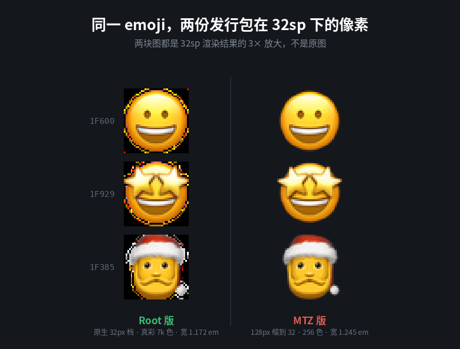

# Chiron Emoji 发行包审计报告

**审计对象**

| 文件 | 字节数 | SHA-256 |
|---|---|---|
| `AppleEmoji_Chiron_v5.0_hd.zip` | 188,861,610 | `f725bfe5…`（内含字体，见 §4） |
| `Chiron-Merriweather_v6.2_AppleEmoji_20261031.mtz` | 56,377,266 | `59355788…`（内含字体，见 §4） |
| ├ `system/fonts/NotoColorEmoji.ttf`（Root） | 188,837,280 | `f725bfe5adefc590c4afab5927cdc363736964d8d84eb7ab1c9a122f8691d2b7` |
| └ `fonts/NotoColorEmoji.ttf`（MTZ） | 18,568,856 | `59355788fdb48d3f01149f0debf1fbcfeb983595a7a0408f352b3a873479788c` |

**方法**：完整解包 → 逐文件读取 → fontTools 解析表结构 → CBDT 位图解码 → 交叉比对。
**本轮只读**：未修改任何原始文件，未生成新的发行包。

---

## 一、文件树

### Root ZIP（17 条目 / 10 文件 / 解包 180.1 MB）

```text
AppleEmoji_Chiron_v5.0_hd.zip
├── META-INF/com/google/android/
│   ├── update-binary          125 B   （Magisk 安装入口）
│   └── updater-script           8 B   （仅 "#MAGISK"）
├── module.prop                554 B
├── system.prop                277 B
├── customize.sh             6,776 B
├── post-fs-data.sh          5,579 B
├── service.sh               2,227 B
├── action.sh                2,270 B
├── scripts/diag.sh          3,726 B
└── system/fonts/
    └── NotoColorEmoji.ttf  188,837,280 B   （180 MB）
```

无 `uninstall.sh`，无 `README`，无 `LICENSE`，无预览图。

**压缩方式：全部 `stored`（0% 压缩）。** 180 MB 原样存储，`zip -0` 打的包。

### MTZ（10 条目 / 8 文件 / 解包 85.0 MB / 压缩后 53.8 MB）

```text
Chiron-Merriweather_v6.2_AppleEmoji_20261031.mtz
├── description.xml              456 B
├── fonts/
│   ├── Roboto-Regular.ttf    69,339,652 B   （66.1 MB，Chiron GoRound TC VF）
│   └── NotoColorEmoji.ttf    18,568,856 B   （17.7 MB）
└── preview/
    ├── preview_fonts_0..3.jpg   4 × ≈292 KB
    └── preview_fonts_small_0.png   14,286 B
```

**缺 `README`、`CHANGELOG`、授权说明、字体来源记录。**

---

## 二、Root 模块：脚本执行链

| 顺序 | 脚本 | 触发时机 | 实际动作 |
|---|---|---|---|
| 1 | `update-binary` | 安装时 | `. /data/adb/magisk/util_functions.sh` → `install_module` |
| 2 | `customize.sh` | 安装时（解包后） | 解析 `fonts.xml` 找 emoji 文件名 → 硬链接铺位点 → **删** `/data/fonts` → **删** 主题目录 `*emoji*.ttf` → 设权限 |
| 3 | `post-fs-data.sh` | 每次开机，`/data` 挂载后、zygote 前 | **删** `/data/fonts` → 主题目录 **覆盖** `*emoji*.ttf` → `chcon` → `mount --bind` 到 `/system/fonts/*emoji*.ttf` → 全失败则 overlayfs 挂 `/system/fonts` |
| 4 | `service.sh` | 开机完成后一次（等待 `sys.boot_completed`，最多 120 s） | 再删 `/data/fonts` → `pm disable` GMS 两个字体组件 → 删 `font_*.dat` 与 `/data/misc/fonts/*` |
| 5 | `action.sh` | 用户点模块「执行」 | 与 3 相同的 bind + 缓存清理 + 跑 `diag.sh` |
| 6 | `diag.sh` | 手动 / 被 `action.sh` 调用 | 只读诊断，输出到 `/sdcard/emoji_diag.txt` |

### 关键设计事实（已从代码确认）

- **`customize.sh` 与 `post-fs-data.sh` 对同一目录的策略相反**：安装时 `rm -f` 删除主题目录里的 emoji 字体，开机时 `cp -f` 覆盖。删除发生在前面，所以**开机那次覆盖永远不会有对象** —— `rm` 之后再 `cp` 是没有意义的死代码。
- 卸载时只有 bind mount（重启即消失）会自动恢复；`/data/adb/chiron_apple_emoji/`（日志 + `ovl_upper`）、被 `pm disable` 的 GMS 组件、被 `rm` 的主题字体，**没有任何回滚路径**。
- `update-binary` 硬编码 `. /data/adb/magisk/util_functions.sh`。KernelSU 有兼容层，APatch 使用 `/data/adb/ap/`，该路径不存在时 `install_module` 未定义，脚本以 `exit 0` 结束 —— **安装"成功"但什么都没装**。与 `module.prop` 声称的「KernelSU / Magisk / APatch 通用」不符。

---

## 三、MTZ `description.xml` 逐字段

```xml
<?xml version="1.0" encoding="UTF-8"?>
<MIUI-Theme>
  <title>Chiron Merriweather</title>
  <author>Chiron × Merriweather × Apple Emoji</author>
  <designer>Chiron × Merriweather × Apple Emoji</designer>
  <version>6.0</version>
  <uiVersion>10</uiVersion>
  <fontWeight>150,200,250,300,350,400,450,500,550,600,650,700</fontWeight>
  <description>Chiron GoRound TC VF · 西文 Merriweather · 彩色 emoji Apple Color Emoji</description>
</MIUI-Theme>
```

| 字段 | 值 | 判断 |
|---|---|---|
| 根节点 | `MIUI-Theme` | ⚠ 两份参照包（昭源環方、早期 MiSans 版）都用 `<theme>`。MIUI 主题引擎通常宽容，但这是偏离规范 |
| `title` | Chiron Merriweather | 与项目名 `Chiron Emoji` 不一致 |
| `version` | `6.0` | ⚠ 文件名 v6.2，配置 6.0，**未同步** |
| `uiVersion` | `10` | 参照包分别为 10 / 4，语义不明，无法从文件判断 |
| `fontWeight` | 11 档 150–700 | 与 `fvar` 轴 150–700 一致 ✓；但 `fonts/` 只有 1 个 `Roboto-Regular.ttf`，其余字重依赖 VF 轴。实机已观察到其余字重被落成 **43 字节空占位文件**（见 §七 证据） |
| `author` / `designer` | 三方联名 | 缺 `locale` 多语言块（`<authors>`/`<titles>`），参照包都有 |
| `description` | 中文一行 | 同上，缺 `<descriptions>` |

**缺失**：`<titles>`、`<authors>`、`<designers>`、`<descriptions>` 四个 locale 块 —— 主题详情页可能显示空标题或回退文件名。

---

## 四、两份 Emoji 字体：二进制级对比

**结论先说：这不是同一个字体，也不是同一次构建的两个规格。** 它们是两套独立流水线的产物，差异覆盖命名、特性标签、位图格式、位图档数、字宽五个层面。

| 项目 | Root 版 | MTZ 版 | 影响 |
|---|---|---|---|
| 文件大小 | 188,837,280 B | 18,568,856 B | 10.2× |
| SHA-256 | `f725bfe5…` | `59355788…` | 不同文件 |
| name 1/4（族名） | Noto Color Emoji | Apple Color Emoji | 不同血统 |
| name 6（PostScript） | `NotoColorEmoji` | `AppleColorEmoji` | 不同 |
| name 5（版本串） | Version 16.0v5 | Version 13.0 | — |
| 字形数 | 3,842 | 3,830 | −12 |
| cmap 单码位 | 1,445 | 1,433 | −12 |
| GSUB 特性标签 | **`ccmp`** | **`liga`** | 见下 |
| 连字规则数 | 3,553 | 3,551 | 字形命名不同（`emoji_u1F3FB` vs `uni1F3FB`）；按码位归一后 3,550 条相同，ROOT 多 3 条、MTZ 多 1 条（见 §4.6） |
| **CBDT 档数** | **5** | **1** | 见下 |
| 位图 ppem | 32 / 45 / 60 / 82 / 128 | **128 单档** | — |
| 位图像素尺寸 | 38 / 53 / 70 / 96 / 150 | 128 单档 | — |
| **PNG 色彩模式** | **RGBA（真彩）** | **P（256 色调色板）** | 见下 |
| **advance width** | **2,400**（1.172 em） | **2,550**（1.245 em） | 见下 |
| glyf 轮廓 | 0 条（全空，纯位图） | 0 条 | 一致 ✓ |
| hhea / typo / win | 1900 / −500 / 500 | 1900 / −500 / 500 | 一致 ✓ |

### 4.1 位图质量：MTZ 版是 256 色量化产物

用 `emoji_u1f600` 的 128 px 档实测：

| 字形 | Root 唯一 RGB 色数 | MTZ 唯一 RGB 色数 |
|---|---|---|
| 😀 U+1F600 | **7,170** | **159** |
| 🤩 U+1F929 | **10,354** | **212** |
| 🎅 U+1F385 | **7,529** | **221** |

`module.prop` 里对 v5.0 的描述是：

> v5.0 修复"发脏/发糊"的根因：v4 为压体积把位图量化成 256 色，Apple 脸部的径向渐变从 6231 色掉到 131 色，出现一圈圈色阶。

**这句话描述的病症，正是 MTZ 版当前的现状。** Root 版已经治好了，MTZ 版没有跟上。

### 4.2 档数：MTZ 版只有一档 128 px

Root 有 5 档（32/45/60/82/128 ppem），系统在 12–32 sp 时可取到原生位图。
MTZ 只有 128 ppem 一档，任何字号都必须由 FreeType 缩放。

### 4.3 字宽：MTZ 版没有做 Android 归一化

| | 位图宽度 / ppem | advance / upem | 图形占格子 |
|---|---|---|---|
| Root | 150 / 128 = **1.172** | 2400 / 2048 = **1.172** | **100%** ✓ |
| MTZ | 128 / 128 = **1.000** | 2550 / 2048 = **1.245** | **80%** ⚠ |

MTZ 版保留了 Apple 原始度量（upem 2048、advance 2550），位图只有 1 em 宽，而格子有 1.245 em —— **图形缩在左边，右边空出 0.245 em**。表现为：emoji 看起来偏小、emoji 之间间距偏大、与中文/西文混排时基线节奏不一致。



*左：Root 版的 32 px 原生档。右：MTZ 版的 128 px 档缩到 32 px。同为 32 sp、同为 3× 放大。*

### 4.4 缺 12 个码位

MTZ 版 cmap 缺以下 12 个字符，会回退到系统字体（在 Apple emoji 里表现为显示成安卓黑白的符号）：

| 码位 | 字符 | 说明 |
|---|---|---|
| U+25AB | ▫ | 白色小方块 |
| U+25FB | ◻ | 白色中方块 |
| U+25FD | ◽ | 白色中小方块 |
| U+2796 | ➖ | 减号 |
| U+1F7F0 | 🟰 | 等号（Unicode 14） |
| U+1FA89 | 🪉 | 竖琴（Unicode 16） |
| U+1FA8F | 🪏 | 铲子（Unicode 16） |
| U+1FABE | 🪾 | 无叶树（Unicode 16） |
| U+1FAC6 | 🫆 | 指纹（Unicode 16） |
| U+1FADC | 🫜 | 根菜（Unicode 16） |
| U+1FADF | 🫟 | 飞溅（Unicode 16） |
| U+1FAE9 | 🫩 | 眼袋脸（Unicode 16） |

前 4 个是老字符，说明 MTZ 版构建时的字符表本身就不完整，不只是 Unicode 版本问题。

### 4.5 GSUB 标签 `ccmp` vs `liga`

Root 用 `ccmp`、MTZ 用 `liga`。HarfBuzz 默认两者都启用，常规路径下都能正确连字。差异在于：任何显式关闭 `liga` 的场景（CSS `font-variant-ligatures: none`、部分 Web 排版引擎、某些 App 自定义的 `Paint` 特性设置）会让 **MTZ 版的肤色修饰符、ZWJ 组合、旗帜全部拆开**，而 `ccmp` 不受影响 —— `ccmp` 属于整形必需特性，几乎没有实现会关闭它。

这是"某些 App 里组合 emoji 散架"的候选解释之一，**需实机验证**。

### 4.6 连字规则的实际差异（按码位归一后）

| | 条数 | 说明 |
|---|---|---|
| 完全相同 | 3,550 | 绝大部分肤色、ZWJ、键帽、家庭序列 |
| 仅 Root 有 | 3 | `U+25AB FE0F`+`FE0F`、`U+25FB FE0F`+`FE0F`、**`U+1F1E8 U+1F1E6`（🇨🇦 加拿大旗）** |
| 仅 MTZ 有 | 1 | `U+1F9D1 U+1F932 ZWJ U+1F9BD`（🧑‍🤲‍🦽 的旧版序列） |

国旗组合缺失意味着 **MTZ 版至少有 1 面旗帜会被拆成两个区域指示符字母**（🇨 + 🇦），而不是显示成旗。这与 §4.4 的 12 个缺失码位属于同一类问题，但成因不同：前者是 cmap 缺字，这里是 GSUB 缺规则。

---

## 五、版本与命名不一致汇总

| # | 位置 | 值 | 冲突对象 |
|---|---|---|---|
| 1 | MTZ 文件名 | `v6.2` | `description.xml` → `6.0` |
| 2 | Root `module.prop` | `version=v5.0`，`versionCode=7` | MTZ 的 `6.2`；同项目主版本号差 1.2 |
| 3 | Root `module.prop` | `name=Apple Color Emoji (Chiron 配套)` | MTZ `title=Chiron Merriweather`；项目名 `Chiron Emoji` |
| 4 | Root 字体 name 5 | `Version 16.0v5` | 发行版本号 `v5.0`；两个"5"含义不同 |
| 5 | MTZ 字体 name 5 | `Version 13.0` | 发行版本 `6.2`；来源不可追溯 |
| 6 | 两包共用词 | "hd" / "HD" | Root 用 HD 指 180 MB 真彩；MTZ 的 emoji 是 17.7 MB 单档量化版，**没有规格标识** |
| 7 | `description.xml` | 无资源版本字段 | 无法从包内判断 emoji 字体属于哪次构建 |
| 8 | `module.prop` | `description` 里写"5 档位图 38/53/70/96/150px，GSUB 连字 3553 条" | 与实际一致 ✓（这是唯一一处准确记录规格的地方） |

**最严重的是 #6**：同一份"Apple Emoji"名义下，两个发行渠道装的是**质量差 10 倍的两种字体**，而用户无从分辨。文档 §3.1 设计的 `Font Resource: Emoji-R6` + `HD/Compact` 变体标识，正是为解决这个问题，目前尚未落地。

---

## 六、安全审查

### 6.1 删除行为

| 位置 | 命令 | 对象 | 风险评估 |
|---|---|---|---|
| `customize.sh` | `rm -rf /data/fonts` | GMS 可更新字体目录 | 会重建；但**删除了用户所有已下载字体**（不止 emoji），Google Play 字体会全部失效直到重新下载 |
| `customize.sh` | `rm -f /data/system/theme/fonts/*[Ee]moji*.ttf` | **用户主题里的 emoji 字体** | **破坏性且无备份**。装完 Root 模块后，用户的 MTZ 主题 emoji 被物理删除，主题重装才能恢复 |
| `post-fs-data.sh` | `rm -rf /data/fonts` | 同上 | 同上，每次开机会再删一次 |
| `post-fs-data.sh` | `rm -rf "$WORK"`（overlay workdir） | 自身目录 | 若上次 overlay 仍挂载，删 workdir 会让 overlay 进入异常状态 |
| `service.sh` | `rm -rf /data/fonts` | 同上 | 第三次 |
| `service.sh` | `rm -f /data/system/font_*.dat`、`/data/misc/fonts/*` | 系统字体缓存 | 会重建，代价是首屏渲染变慢 |

**`customize.sh` 的 `rm` 与 `post-fs-data.sh` 的 `cp` 互相矛盾**：安装时删掉，开机时又想复制（已无对象）。如果用户装了 v6.2 主题后再装 Root 模块，主题的 emoji 会被删；而 Root 的 bind 若失败（本机已实证失败），结果是**两头落空**。

### 6.2 禁用系统服务

```sh
pm disable --user <每用户> com.google.android.gms/com.google.android.gms.fonts.provider.FontsProvider
pm disable --user <每用户> com.google.android.gms/com.google.android.gms.fonts.update.UpdateSchedulerService
```

- 遍历 `/data/user/*`，对**所有用户**（含分身）执行。
- **不可逆**：无 `uninstall.sh`，卸载模块后这两个组件仍是 disabled。用户会在"设置 → 显示 → 字体"里发现 Google 字体下载功能永久消失，且不知道原因。
- 影响面**大于 emoji**：FontsProvider 是所有可下载字体的统一入口，不只是 emoji。
- 另有 `system.prop` 的 `ro.com.google.gmscore.font_provider.disabled=1`，等于把这条路封了两遍。

### 6.3 挂载

| 行为 | 风险 |
|---|---|
| `mount --bind $SRC /system/fonts/*emoji*.ttf` | 中等。单个文件 bind 可逆（重启消失），SELinux 已 `chcon` |
| **overlayfs 挂 `/system/fonts`**（bind 全失败时的回退） | **高**。upperdir 在 `/data/adb/…/ovl_upper`，目录本身的 SELinux 标签是 `magisk_file`，只 `chcon` 了里面的 ttf。若 `system_server` 在 mount 后、字体解析前读取失败，会导致**系统 UI 起不来 → 无限重启**。脚本的回滚只检查"3 个基础字体文件非空"，不检查能否加载，这个探测不足以判定安全 |

### 6.4 磁盘占用

`customize.sh` 的 `link_in()` 先 `ln`（硬链接，同分区不占额外空间），失败才 `cp -f`。若 `/data/adb/modules` 与目标目录不同分区导致 `ln` 失败，最多会产生 **3 份 180 MB 拷贝 = 540 MB**，在存储紧张的设备上直接写满 `/data`。当前脚本对此没有任何检查或告警。

### 6.5 可恢复性总表

| 变更 | 重启后 | 卸载模块后 |
|---|---|---|
| bind mount | 自动消失 ✓ | ✓ |
| overlayfs 挂载 | 自动消失 ✓ | ✓ |
| `/data/fonts` 被删 | GMS 会重建（部分） | 部分恢复 |
| 主题目录 emoji 被删 | **不恢复** ✗ | **不恢复** ✗ |
| GMS 组件 disabled | **保持 disabled** ✗ | **保持 disabled** ✗ |
| `/data/adb/chiron_apple_emoji/` | 保留 | **保留**（无清理） |
| `font_*.dat` 被删 | 重建 ✓ | ✓ |

`module.prop` 写「随时可禁用还原」。**这句话目前不成立。**

---

## 七、证据链中的一个时间错位（重要）

维护者提供的 `emoji_diag.txt` 时间戳为 `2026-10-29 17:01`，而 v5.0 中 `post-fs-data.sh` 的文件时间是 `17:05`。诊断日志里：

```
13:06:23 post-fs-data start
13:06:23 source: 115970024 bytes        ← 115 MB，不是 v5.0 的 188 MB
13:06:23 removed /data/fonts
13:06:23 theme: no emoji font to replace
13:06:23 live: /system/fonts/NotoColorEmoji.ttf = 2992136 bytes
13:06:23 post-fs-data done
```

**没有 `chcon`、没有 `bind OK/FAILED`、没有 `bind summary` 三行** —— 而这三行在 v5.0 的脚本里是无条件打印的。说明这份诊断跑的是 v5.0 定稿**之前**的中间版本，字体也只有 115 MB。

因此：**这份日志不能用来判定 v5.0 定稿版的挂载行为**，只能作为"当时那版确实一次都没挂上"的证据。这一点恰好印证文档 §2 的告诫——旧对话里的检查记录必须重新验证。

不过它仍然贡献了三条可用事实：

1. 系统 `fonts.xml` 里 emoji 家族有 **3 个**：`NotoColorEmojiLegacy.ttf`（`ignore="true"`）、`NotoColorEmoji.ttf`、`NotoColorEmojiFlags.ttf`（872,756 B）。而 `customize.sh` 的硬编码兜底名单只有前两个 + `MiSansEmoji.ttf` —— **漏了 Flags**。只有当 awk 从 XML 解析成功时才会补上，解析失败就漏。
2. `/data/system/theme/fonts/` 里除 `Roboto-Regular.ttf`（69,339,652 B，即本项目的 VF）外，其余 17 个字重文件**全部是 43 字节的占位文件**。
3. `/data/fonts` 不存在，主题目录无 emoji 字体（当时装的是不含 emoji 的纯字体版）。

第 2 条值得单独说明：`description.xml` 声明 11 档字重，主题引擎为每档建了 43 字节空文件。这说明**声明与实际提供的文件不匹配时会生成坏占位**，任何请求非 Regular 字重的应用可能拿到一个 43 字节的无效字体。属**需实机验证**的兼容性风险。

---

## 八、分级结论

### A. 已从文件确认（可直接采信）

1. 两份 emoji 字体不是同一构建：SHA 不同、族名不同、字形数 3842 vs 3830。
2. MTZ 版位图为 **256 色调色板 + 单档 128 px**；Root 版为 **真彩 RGBA + 5 档**。
3. MTZ 版 advance width **2550**（1.245 em），Root 版 **2400**（1.172 em）；MTZ 的图形只占格子 80%。
4. MTZ 版缺 12 个码位，其中 8 个是 Unicode 16 新增，4 个是旧符号（▫◻◽➖）。
5. MTZ 版 GSUB 标签为 `liga`，Root 版为 `ccmp`。
6. Root 模块 `customize.sh` 会 `rm -f` 删除用户主题目录里的 emoji 字体，且无备份。
7. Root 模块无 `uninstall.sh`；`service.sh` 的 `pm disable` 无对应恢复逻辑。
8. Root ZIP 全部条目 `stored` 未压缩，包体 180.1 MB，其中 180 MB 是单个字体。
9. `description.xml` 的 `version=6.0` 与文件名 `v6.2` 不一致；根节点为 `MIUI-Theme` 而非参照包的 `theme`；缺四个 locale 块。
10. MTZ 内 `Roboto-Regular.ttf` 的垂直度量已是修正后的值（hhea 1078/−348、typo 976/−246/200、win 1078/348），`fvar` 轴 150–700、默认 330。
11. `update-binary` 只兼容 `/data/adb/magisk/` 路径。

### B. 根据代码推断（逻辑成立，未见实机）

1. APatch 环境下 `install_module` 未定义 → 安装静默失败，与「APatch 通用」不符。
2. 装了 v6.2 主题后再装 Root 模块，主题的 emoji 会被删而 bind 可能失败 → 两头落空。
3. overlayfs 回退路径若挂载成功但字体加载失败，可能导致 system UI 循环崩溃；脚本的回滚探测不足以覆盖这种情况。
4. `pm disable` 后用户侧「字体下载」功能会一并失效，不止 emoji。
5. 若 awk 未能从 `fonts.xml` 解析出文件名单，`NotoColorEmojiFlags.ttf` 不会被接管，旗帜会保持安卓样式。

### C. 需要实机验证

1. HyperOS 4.0 主题引擎是否接收 `fonts/` 下第二个 TTF（`NotoColorEmoji.ttf`），是否写入 `/data/system/theme/fonts/`。
2. 主题引擎对 `<MIUI-Theme>` 根节点、缺失 locale 块的容忍度。
3. 43 字节占位文件是否会让 Bold/Medium 请求拿到坏字体。
4. MTZ 版的 `liga` 标签是否在某些 App 里导致组合 emoji 拆开。
5. 5 档 vs 1 档在 12–16 sp 下的实际清晰度差异（截图对比）。
6. v5.0 定稿版（188 MB）在本机的 bind 结果 —— 现有日志不含 bind 记录。

### D. 需要维护者确认

1. **字体授权**：Apple Color Emoji 的来源、修改与再分发许可。这是能否公开发行的前置条件，目前两个包内都**没有任何授权声明文件**。
2. **公开方式**：仅酷安 / 酷安 + GitHub / GitHub 仅做发行。
3. **两个 emoji 字体是否有意做成不同规格**，还是 MTZ 版只是历史遗留未更新。
4. **Root 支持范围**：实际实测过哪些 Android / HyperOS 版本与 Root 管理器（当前 `module.prop` 声称三者通用，代码只支持 Magisk 路径）。
5. **项目命名**：`Chiron Emoji` / `Chiron Merriweather` / `Apple Color Emoji (Chiron 配套)` 三者关系。
6. **180 MB 单文件**是否为可接受的发行体积，是否有 Compact 计划。

---

## 九、整改建议

### P0 — 发布前必须处理

| # | 问题 | 建议 | 影响文件 |
|---|---|---|---|
| 1 | MTZ 的 emoji 是 256 色单档量化版 | 用 Root 版的同一字体源重建 MTZ 版；若体积不可接受，做**双档**（64 + 128）真彩而非单档量化 | `fonts/NotoColorEmoji.ttf` |
| 2 | advance width 2550 未归一化 | 统一改为 2400 / upem 2048，位图按 1.172 em 出图 | 同上 |
| 3 | `customize.sh` 删除用户主题 emoji | 改为 `cp -f` 覆盖或直接不动（`post-fs-data.sh` 已是覆盖策略），并加备份 | `customize.sh` |
| 4 | `pm disable` 不可逆 | 新增 `uninstall.sh` 恢复 GMS 两个组件；或改用更小的影响面（仅清 `/data/fonts` 而不 disable） | `service.sh` + 新增 `uninstall.sh` |
| 5 | overlayfs 回退风险过高 | 移除该回退，或在挂载前先 `mount --bind` 一次自检、挂载后 `fc-list` 式探测；失败必须 `umount -l` 且记录 | `post-fs-data.sh` |
| 6 | 无授权声明 | 两个包内加 `LICENSE` / `NOTICE`，说明字体来源与许可；未确认前不公开发布字体二进制 | 两包 |

### P1 — 影响体验与可维护性

| # | 问题 | 建议 |
|---|---|---|
| 7 | MTZ 缺 12 个码位 | 用 Root 版同一源重建，字符表对齐 |
| 8 | `liga` vs `ccmp` | 统一为 `ccmp`（整形必需特性，不依赖 App 是否开启 liga） |
| 9 | 版本号三套 | 按文档 §3.1 落地：Project `6.0.0` / Root `6.0.0` / MTZ `6.0.0` / Resource `Emoji-R6-HD`、`Emoji-R6-Compact`；`description.xml` 的 `<version>` 与文件名同步 |
| 10 | `description.xml` 结构 | 根节点改 `<theme>`，补 `<titles>`/`<authors>`/`<designers>`/`<descriptions>` 四个 locale 块 |
| 11 | APatch 声称不符 | `update-binary` 增加 `[ -f /data/adb/magisk/util_functions.sh ]` 判断与 APatch 分支；或直接在 `module.prop` 去掉 APatch |
| 12 | `NotoColorEmojiFlags.ttf` 可能漏接管 | 硬编码兜底名单补上 Flags；解析失败时至少覆盖 3 个已知位点 |
| 13 | 180 MB stored 未压缩 | 改为 deflate，或在文档里说明为何必须 stored |
| 14 | 缺资源版本记录 | `Resources/Metadata/checksums.txt` 记录每个字体 SHA-256 与构建参数 |

### P2 — 发行体系

15. `README` / `CHANGELOG` / `Compatibility` / `FAQ` / `Coolapk-Release` 五件套（文档 §7.3）。
16. 问题反馈模板（文档 §7.4）直接贴进酷安帖子。
17. 兼容性矩阵按「设备 + ROM + Root 方案 + 发行版 + 资源版本」记录，禁止用单机结果外推。
18. 把 `diag.sh` 的输出格式与反馈模板对齐（当前 diag 已相当完整，只需加一节"字体资源 SHA"）。

---

## 十、本轮未做的事

- 未修改任何原始文件。
- 未重新构建或生成发行包。
- 未验证任何"实机行为"结论 —— §8.C 的六条全部需要真机。
- 未核查字体授权（无授权文件可查，只能向维护者确认）。

---

*报告基于对两份发行包的完整解包与字体表解析，所有数值可用 fontTools 复现。*
